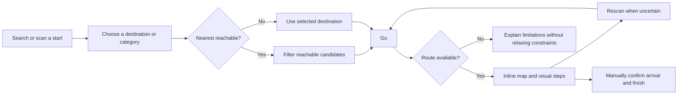
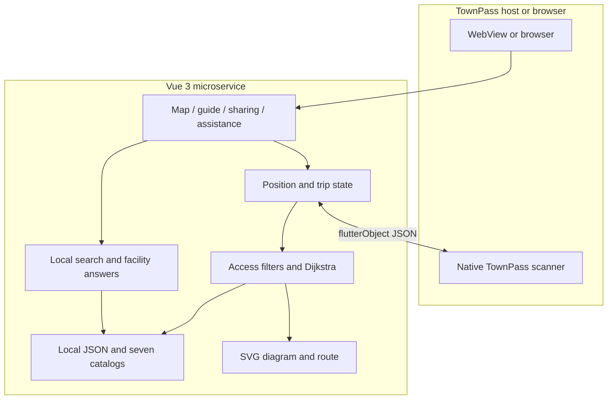
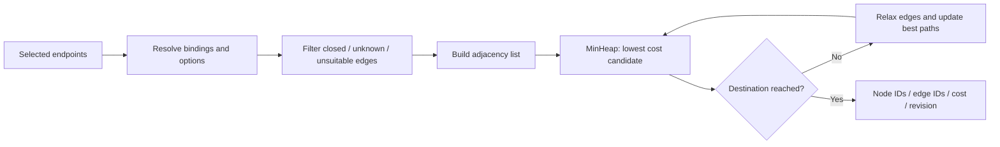
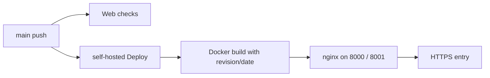

<div align="center">

# Taipei Main Station Wayfinding · 北車不迷路

**Find facilities, choose a reachable route, and follow readable visual directions inside TownPass.**

[](https://github.com/yoyo899843/CodeFest-2026-Taipei-Maze/actions/workflows/web-ci.yml)
[](./LICENSE)


[繁體中文](./README.md) · **English**

[Try the service](https://codefest.yoyo899843.com/station-map) · [Changelog](./CHANGELOG.md) · [Contributing](./.github/CONTRIBUTING.md) · [Architecture](./.github/ARCHITECTURE.md)

</div>

We built **Taipei Main Station Wayfinding**, a **TownPass WebView microservice**, to help people find facilities, understand their next step and recover when unsure of their position. We connect search, reachable routes, QR recovery, visual guidance and fixed meeting places in one flow.

We run core search and routing against local data. You can try manually selected endpoints in a browser, then use native QR scanning through TownPass.

We preserve our competition work as **`v0.1.0`**, including a partial diagram graph and the main interaction flow. It records our implementation of station wayfinding, readable interfaces and access constraints; it is not an emergency navigation service or a certified wheelchair route.

## Contents

[Why](#why-this-project) · [Screenshot](#actual-screenshot) · [Floor maps](#full-floor-maps) · [Features](#features-and-scope) · [Privacy](#privacy-and-permissions) · [Quick start](#quick-start) · [Walkthrough](#walkthrough-and-demo) · [Architecture](#architecture) · [Shortest paths](#how-we-compute-shortest-paths) · [Data](#data-and-coverage) · [Tests](#tests-and-quality) · [Deployment](#deployment-and-versioning) · [License](#provenance-and-licensing) · [Contributors](#contributors)

## Why this project

Station navigation involves more than finding a dot: a nearby restroom may be separated by a wall, a transfer may require a different floor, and a meeting place can be difficult to describe. We connect these tasks into one recoverable flow.

| User need | Approach |
| --- | --- |
| Find a facility that can actually be reached | Rank candidates by allowed graph path cost, not straight-line proximity |
| Understand the next action without switching screens | Keep map, direction icon, landmarks and previous/next controls together |
| Recover when uncertain about position | Keep the destination, confirm a new QR position, then recompute |
| Reduce reading and language barriers | Seven languages, local synonyms, Zhuyin/large-text preferences and expandable information |
| Meet friends or explain a problem to staff | Share a fixed place and show a staff-facing assistance card |

We use “understand what to do next” as the shared goal behind our interface and navigation flow.

## Actual screenshot

We bring facility search, routing and position recovery into one interface. Explore the actual mobile and wide-screen views below; select an image to open the original.

> We capture the production website with Playwright driving Chrome (mobile 430 × 932, wide screen 1440 × 1000) after real interactions. These are browser captures, not Android/iPhone WebView or field-validation records. Revision, URL and layout metrics are recorded in [`assets/screenshots/manifest.json`](./assets/screenshots/manifest.json).

<table>
<tr><th>Facilities and floor map</th><th>Destination search</th><th>Inline map and directions</th></tr>
<tr><td align="center"><a href="./assets/screenshots/mobile-home.png"></a></td><td align="center"><a href="./assets/screenshots/mobile-destination-search.png"></a></td><td align="center"><a href="./assets/screenshots/mobile-route-m8.png"></a></td></tr>
</table>

### Step-free routing and floor changes

<table>
<tr><th>Endpoints and step-free option</th><th>Starting on B4</th><th>Elevator floor change</th></tr>
<tr><td align="center"><a href="./assets/screenshots/mobile-step-free.png"></a></td><td align="center"><a href="./assets/screenshots/mobile-route-b4.png"></a></td><td align="center"><a href="./assets/screenshots/mobile-floor-transfer.png"></a></td></tr>
</table>

### Facility helper, sharing and assistance

<table>
<tr><th>Local facility answers</th><th>Fixed-place sharing</th><th>Staff assistance card</th></tr>
<tr><td align="center"><a href="./assets/screenshots/mobile-helper.png"></a></td><td align="center"><a href="./assets/screenshots/mobile-share.png"></a></td><td align="center"><a href="./assets/screenshots/mobile-staff-help.png"></a></td></tr>
</table>

### Child, elder and English interfaces

<table>
<tr><th>Child / Zhuyin mode</th><th>Elder / large-text mode</th><th>English interface</th></tr>
<tr><td align="center"><a href="./assets/screenshots/mobile-child.png"></a></td><td align="center"><a href="./assets/screenshots/mobile-senior.png"></a></td><td align="center"><a href="./assets/screenshots/mobile-english.png"></a></td></tr>
</table>

### Information and wide-screen guidance

<p align="center"><a href="./assets/screenshots/mobile-information.png"></a></p>

[](./assets/screenshots/desktop-route.png)

## Full floor maps

The left column shows the full in-app map of each floor at 1× zoom. The right column shows the walking-network coverage of the same floor, generated from `walking-network.json` by [`render-walking-maps.mjs`](./app/scripts/render-walking-maps.mjs). Legend:

- Teal solid lines: corridors derived from the Taipei Metro station plan.
- Orange dashed lines: corridors derived from schematic redraws (1F and the B2 railway platforms).
- Grey dotted lines: inferred entrances with unknown accessibility; step-free routes never use them.
- Grey blocks: non-metro areas such as car parks; routes never cross them.
- Dark dots: bound places.
- Red rings: places not bound to the network.

<table>
<tr><th>Floor</th><th>App map</th><th>Walking network</th></tr>
<tr><td align="center"><b>1F</b><br>46 / 46</td><td><a href="./assets/maps/floor-1f.png"></a></td><td><a href="./assets/maps/walk-1f.svg"></a></td></tr>
<tr><td align="center"><b>B1</b><br>42 / 44</td><td><a href="./assets/maps/floor-b1.png"></a></td><td><a href="./assets/maps/walk-b1.svg"></a></td></tr>
<tr><td align="center"><b>B2</b><br>86 / 86</td><td><a href="./assets/maps/floor-b2.png"></a></td><td><a href="./assets/maps/walk-b2.svg"></a></td></tr>
<tr><td align="center"><b>B3</b><br>35 / 35</td><td><a href="./assets/maps/floor-b3.png"></a></td><td><a href="./assets/maps/walk-b3.svg"></a></td></tr>
<tr><td align="center"><b>B4</b><br>17 / 17</td><td><a href="./assets/maps/floor-b4.png"></a></td><td><a href="./assets/maps/walk-b4.svg"></a></td></tr>
</table>

```bash
cd app
npm run build:walking       # rebuild the walking graph
npm run render:walking-maps # regenerate the coverage maps in the right column
```

## Features and scope

- **Searchable endpoints:** collapsible floor groups, category/name/operator/exit-code/number matching, multilingual synonyms and bounded typo tolerance.
- **Nearest reachable facilities:** reuse the selected start and route restrictions; one primary Go action.
- **Step-free routing:** remove stairs, escalators and unknown accessibility edges before routing; do not silently relax constraints.
- **Inline guidance:** floor polylines, direction icons, landmarks, floor transitions and previous/next steps beside a map with adaptive height.
- **QR recovery:** a small confirmation dialog invokes existing single-scan TownPass capability. Cancellation preserves the trip.
- **Sharing and assistance:** share either fixed endpoint, show a staff card, rescan/cancel from the lower control group, and explicitly confirm arrival.
- **Reading preferences:** standard, child and elder modes; Zhuyin, larger text, themes and reduced-motion handling.
- **Seven local catalogs:** Traditional Chinese, English, Vietnamese, Indonesian, Thai, Korean and Japanese.
- **Local facility helper:** factual station-data answers, progress events, incremental text and facility cards; suggestions remain reusable.

We center this competition version on local search, diagram routing, inline guidance and position recovery. Our [Competition version scope](#competition-version-scope) describes the boundaries of each capability.

## Privacy and permissions

The main flow works without handing over personal data:

- **No account, GPS or notifications:** search, routing and guidance need no sign-in. Indoor position comes only from a QR code the person chooses to scan; we do not use GPS or track position or heading in the background.
- **A QR scan describes only that moment:** we use it to confirm where someone is now. We never infer which way they face from a QR code and do not keep a movement history.
- **Sharing sends a fixed place:** a shared link carries only a place ID, never the sender's position, time or route; it is not live location sharing.
- **No remote AI, translation or speech services:** the seven languages, Zhuyin and helper answers come from local data, and questions are not sent to a cloud model.
- **Microphone only on request:** optional voice input asks for permission only after the person taps it, and typing always remains available.
- **The staff card stays on the phone:** the screen shown to station staff uploads nothing.

## Quick start

We develop and verify the web app with **Node.js 20, npm and Git**. You can run search and routing without first setting up Flutter, model weights, an API key or a database.

```bash
git clone https://github.com/yoyo899843/CodeFest-2026-Taipei-Maze.git
cd CodeFest-2026-Taipei-Maze/app
npm ci
npm run serve -- --host 127.0.0.1 --port 8082
```

Open <http://127.0.0.1:8082/>. `/` redirects to `/station-map`; `/about` provides source/version/license information; `/meet` is the meeting-place entry. Historical test/orientation routes redirect to the station map.

### Browser versus TownPass

We support manual endpoints, search, routing, map interaction, steps, fixed-point sharing and local answers in a browser. Inside TownPass, we use `flutterObject` to call `qr_code_scan`; manual selection remains available without that bridge.

We confirm position at scan time and express directions in map bearings. Our current flow does not use GPS for indoor positioning or continuously track the phone's position or heading.

We keep the navigation UI and core logic on the web and reuse the host's native scanning capability. Our [TownPass integration notes](./integration/townpass/README.md) describe bridge and optional capability boundaries.

### Testing inside TownPass (local simulator)

TownPass is a **separate checkout** that this project does not modify; `integration/townpass/` only keeps earlier integration experiments and license records and is never applied automatically. If your local TownPass already has test entries, they map as follows:

| Entry | Web source | Best for |
| --- | --- | --- |
| CodeFest live preview | `127.0.0.1:8082` on the development computer (`npm run serve` above) | Simulators; reload to see code changes |
| CodeFest test environment | Web bundle packaged into the app, served on the phone at `127.0.0.1:8766` | Physical devices or offline use; repackage after web changes |

```bash
bash scripts/townpass-env.sh bundle-web   # package the current app/dist into the TownPass assets
bash scripts/townpass-env.sh build-ios --no-pub
```

On a physical phone, `127.0.0.1` is the phone itself and cannot reach the computer's port 8082, so devices must use the packaged bundle. Scanning, back navigation, background recovery and dual-platform behavior still need on-device validation; see the [integration notes](./integration/townpass/README.md).

## Walkthrough and Demo



1. Select a start and destination; optionally swap or share either point. An existing start does not require another scan.
2. For nearby facilities, choose a category and enable Nearest reachable. Enable Step-free route when needed.
3. Select Go. Compare the map, direction and landmarks. Advancing a step does not update actual position.
4. Rescan if uncertain; manually confirm arrival and finish without fabricating a new QR position.

### Reproducible scenarios

| Scenario | Start → destination | Conditions / expected result |
| --- | --- | --- |
| Same-floor restroom | `b1-e4` → `b1-wc-m5` | Ordinary route succeeds |
| Short floor transfer | `b3-info` → `b4-e2` | Ordinary route succeeds |
| Elevator transfer | `b3-e2` → `b4-e2` | Step-free model route succeeds |
| B4 wheelchair waiting area to M8 | `b4-wait-n` → `b1-exit-m8` | Enable step-free; 12 steps; ends at the **B1 exit point, not a verified street-level exit** |
| Conservative refusal | `b1-e4` → `b1-wc-m5` | Step-free returns no route; insufficient data does not prove actual inaccessibility |

[Load B4 → M8 endpoints](https://codefest.yoyo899843.com/station-map?start=b4-wait-n&destination=b1-exit-m8), then explicitly enable step-free routing. `/station-map?demo=1` provides fixed scenarios, simulated movement and equipment outages. Keep simulation labels visible; these are not field-position evidence.

## Architecture



- **UI:** We combine Vue 3, Vue Router, JavaScript ES modules, HTML/CSS and SVG.
- **Routing:** We expand compact JSON into a directed graph, apply hard access filters, then run Dijkstra with the same restrictions for nearest facilities.
- **Search:** We use Unicode normalization, a local synonym/intent dictionary and Optimal String Alignment.
- **State:** We separate QR, manual, link and Demo sources and tie manual arrival to the current trip.
- **Assistant:** We use internal `thinking`, `delta` and `done` events to keep local queries separate from progressive UI rendering.
- **Delivery:** We build static assets through Docker, serve them with nginx and run checks/deployment through GitHub Actions.

### Technology stack

| Layer | Technology |
| --- | --- |
| Web | Vue 3, Vue Router, JavaScript ES modules, HTML/CSS, SVG (built with Vue CLI) |
| Routing and search | Custom Dijkstra routing with access filters, Unicode normalization, Optimal String Alignment typo tolerance, local multilingual dictionary |
| Data | Versioned JSON (places, floor connections, compact walking graph), seven message catalogs, Zhuyin lexicon |
| Host integration | TownPass (Flutter) WebView, `flutterObject` JSON bridge, native `qr_code_scan` |
| Quality | Node.js built-in test runner, Vue SFC renderer tests, ESLint, Prettier, asset consistency validation, Python `unittest`, GitHub Actions |
| Delivery | Multi-stage Docker build, nginx static site, Docker Compose, Cloudflare Tunnel or an existing reverse proxy |

### Repository layout

```text
.
├── app/
│   ├── src/
│   │   ├── components/     # reusable and station UI
│   │   ├── views/          # route-level composition and station diagrams
│   │   ├── station/        # diagram graph, routing, position and place sharing
│   │   ├── navigation/     # core routing/bridge primitives and test fixture
│   │   ├── search/         # local multilingual search
│   │   ├── chat/           # local answers, stream events and native adapter
│   │   ├── display/        # reading preferences and Zhuyin
│   │   ├── i18n/           # seven catalogs and place names
│   │   ├── meeting/        # fixed meeting-place data and logic
│   │   └── staff/          # assistance data
│   ├── tests/              # Node and Vue renderer regression tests
│   ├── scripts/            # asset validation and graph generation
│   └── Dockerfile
├── assets/screenshots/     # actual screenshot and provenance
├── data/                   # attributed research snapshots and source index
├── tools/                  # data, QR, bundle and model maintenance tools
├── integration/townpass/   # historical patches, diagnostics and notices
├── scripts/                # opt-in historical host tooling
├── .github/                # CI and contributor/architecture/security guides
├── compose.yml
├── README.md               # default Traditional Chinese documentation
└── README.en.md            # English edition
```

We separate navigation, search, position state and presentation by feature so that we can test and maintain them independently. See [Architecture](./.github/ARCHITECTURE.md) for contracts and boundaries.

### How we compute shortest paths

We model navigation as a weighted directed graph `G = (V, E)`. Nodes represent facilities, corridor turns and connector endpoints. We resolve a selected place ID through a binding before routing.

Our current expanded graph has **519 nodes and 4,458 directed edges**, comprising 2,210 corridor pairs (640 of them from schematic redraws of 1F and the B2 platforms) and 38 vertical directed edges. 226 nodes bind selectable places; the others mainly support entrances and turns. We do not expose every helper node as a facility or QR anchor.

#### 1. Building a walkable diagram graph

We explicitly run `npm run build:walking` after changing diagram sources to invoke our [graph builder](./app/scripts/build-walking-network.mjs). The regular `npm run build` only builds the web app and does not regenerate the graph:

1. Load walkable floor polygons and exclude context regions outside the modeled station space.
2. Add bound facilities and helper nodes inset from corners.
3. Validate ordinary same-floor segments with `segmentInWalkAreas` and diagram clearance checks.
4. Retain up to eight nearest visible neighbors per node and deduplicate pairs. Other nodes can link back, so final degree can exceed eight.
5. Add separate inferred entrance edges for some off-corridor icons, with unknown accessibility; step-free requests reject them.
6. Add vertical edges only from recorded connector endpoints, then validate IDs, positive costs, floors, provenance and access fields.

We store each two-way corridor once and expand both directions at runtime. This is a sparse diagram graph: our result is the **minimum-cost path in that graph**, not necessarily the geometric optimum in continuous space or the actual station's complete route network.

#### 2. Defining cost

```text
corridor cost = round(hypot(x₂ − x₁, y₂ − y₁), 1 decimal place)
elevator floor-change cost = 120
stairs / escalator floor-change cost = 90
route cost = sum of allowed edge costs
```

We use fixed floor-change costs to express switching overhead. We have not calibrated them against walking, elevator waits or congestion, so we report diagram cost rather than fastest journey minutes.

For step-free routing, we remove unsuitable edges instead of assigning stairs a large penalty. A costly alternative must not make stairs admissible.

#### 3. Filtering before Dijkstra

Our [walking router](./app/src/station/walking.mjs) constructs an allowed subgraph for each request:

| Condition | Our action |
| --- | --- |
| Not open, or explicitly unverified | Exclude |
| Ticket required but not allowed | Exclude; fare gates/paid areas are not fully modeled yet |
| User-excluded edge type | Exclude |
| Unavailable connector ID | Exclude |
| Step-free request with stairs/escalator | Exclude |
| Step-free request without both `stepFree === true` and `wheelchairPassable === true` | Exclude |

We admit diagram-checked edges without describing them as field-verified. Ordinary and step-free requests therefore share the same data but use different permitted subgraphs.



#### 4. Dijkstra implementation choices

Our [core](./app/src/navigation/dijkstra.mjs) uses an adjacency list, `MinHeap`, `best` candidates and a `settled` set:

- We initialize the start with zero cost and pop the lowest cumulative-cost candidate.
- We relax neighbors using `candidate = current.cost + edge.cost` and push improvements.
- We use lazy updates rather than decrease-key: stale heap entries are discarded when popped.
- We treat costs within `1e-9` as approximately equal and use edge-ID path keys for stable tie decisions.
- We return when the destination is popped, `NoRoute` when the queue empties, and `InvalidGraph` for non-finite accumulated cost.

With `V` nodes and `E` directed edges, basic lazy-heap work is approximately `O((V + E) log E)`. We also copy candidate node/edge arrays and compare path keys, adding route-length-dependent time and memory overhead beyond the textbook distance-only version.

We favor traceable behavior at the current scale. Predecessor-based reconstruction and adjacency reuse reduce copying and rebuilding overhead; this competition version favors directly traceable full-path candidates. A* requires a compatible heuristic and is outside this implementation.

### Reproduce the B4 wheelchair waiting area → M8 step-free query locally

Run from `app/`:

```bash
node --input-type=module <<'JS'
import { readFileSync } from "node:fs";
import {
  walkingRouter,
  planWalk,
  routeSteps,
} from "./src/station/walk-route.mjs";

const graph = JSON.parse(
  readFileSync("src/station/walking-network.json", "utf8")
);
const result = planWalk(walkingRouter(graph), {
  startId: "b4-wait-n",
  destinationId: "b1-exit-m8",
  stepFree: true,
});
console.log({
  status: result.type,
  cost: result.route?.cost,
  steps: routeSteps(result.route).length,
});
JS
```

With the current graph we get `success`, cost `1316.7` and `12` steps. We route only to the B1 M8 diagram point; this version does not include the street-level segment.

### How we find the nearest reachable facility

We filter enabled candidates by category and, for step-free requests, require `accessibleFacility === true`. We then route to each candidate with identical restrictions, discard failures and sort successes by cost, using point IDs to break ties.

```text
candidate facilities → same start and access options → route each candidate
                     → keep successful routes → sort by graph cost → top k
```

With `K` candidates, we currently perform roughly `K` point-to-point searches plus sorting. We do not claim that this is already a single Dijkstra traversal. We choose per-candidate routing to reuse one access-validation entry point. Single-source distance reuse and reverse-graph multi-source search are engineering alternatives for different scales, rather than implemented features here.

We distinguish reaching a facility from the facility itself meeting a requirement. A familiar name does not establish accessible entrances or corridors.

### Turning routes into visual instructions

Our [presentation helpers](./app/src/station/walk-route.mjs) produce per-floor polylines and `walk`, `floor` and `arrive` steps:

- We split walking sections at named places or turns of at least **35°**, ignoring vectors shorter than **two diagram units** to reduce coordinate noise.
- We end highlighted geometry at the actual turn while naming the next recognizable checkpoint. Internal `corner-*` and `*-entrance` IDs are not public facilities or QR points.
- We close the current walking section before a vertical edge and show the connector, target floor and up/down direction separately.
- We derive map bearings with `atan2(Δx, -Δy)`: 0° points up the diagram and angles increase clockwise. These are not measured phone headings.
- We size the map using the visible viewport and measured surrounding controls, favor the map as the main visual area and allow normal page scrolling when crowded.

Several consecutive steps can refer toward the same named facility while highlighting distinct corridor turns. We derive steps from geometry rather than playing a fixed instruction script.

### Multilingual search and typo tolerance

In our [search module](./app/src/search/search.mjs), we normalize NFKC, case and spacing, then combine floor parsing, dictionary synonyms, intents and name/exit-code matching. Only eligible unresolved queries enter fuzzy matching.

We use **Optimal String Alignment** over Unicode code points for insertion, deletion, substitution and adjacent transposition costs. A comparison of lengths `m` and `n` takes `O(mn)` work; we retain only recent rows rather than a full matrix.

| Alias length | Maximum edit distance |
| --- | ---: |
| Under four code points | No fuzzy correction |
| Four to seven | 1 |
| Eight or more | 2 |

We also cap the distance ratio at 0.3, exclude code/number-like aliases from this correction and share a default budget of **100,000 DP cell operations** across a query. Exhaustion returns `incomplete`; fuzzy matches are suggestions, and unresolved modifiers or conflicts request clarification.

Search candidates start with `reachability: "unknown"`; the routing engine establishes graph reachability separately. Our search core requests further handling for nearest intent, and the UI delegates that task to the nearest-facility router rather than treating text matching as path ranking.

### Keeping position and trip state consistent

We separate QR, manual, link and Demo position sources. A manual arrival receipt is tied to endpoints, position token, step-free options, excluded edge types and unavailable connectors; relevant changes invalidate it.

The legacy TownPass scanner has no request ID, so we share a channel for same-name requests: one pending scan, a draining state after timeout, and quarantine of late replies before retry. We also handle duplicate iOS events and remount/HMR ownership so a reply is not reused accidentally.

Our helper uses local `thinking`, `delta` and `done` events for processing status, text and cards, with stop/collapse cancellation. These UI events are separate from position updates and native model token streaming.

## Data and coverage

| Floor | Displayed places | Bound to walking graph |
| --- | ---: | ---: |
| 1F | 46 | 46 (schematic redraw) |
| B1 | 44 | 42 |
| B2 | 86 | 86 (including schematic redraws of four platforms) |
| B3 | 35 | 35 |
| B4 | 17 | 17 |
| **Total** | **228** | **226** |

We use versioned graph data with 19 recorded floor connections and **relative diagram costs**, without converting them to surveyed meters or journey time.

- **1F concourse and B2 TRA/THSR platforms:** bound through schematic redraws. Their corridors are marked `schematic` with their own sources and can be routed within each area. No reliable source yet connects them to metro floors B1–B4, so we **have not invented any vertical links**; routes from the metro area to 1F or a platform honestly report that no route exists.
- **Two unbound points:** `b1-qr-01` (outer corner of the Airport MRT block) and `b1-qr-05` (east edge of the east car park) are demo QR anchors whose coordinates are pinned by an earlier decision. No metro corridor reaches them, so they stay unbound.
- See [Full floor maps](#full-floor-maps) for each floor's coverage.

We use the following sources to build and review the station data:

| Data | Provider | Link | Use |
| --- | --- | --- | --- |
| Taipei Main Station plan (B1–B4) | Taipei Rapid Transit Corporation | [051.pdf](https://web.metro.taipei/img/ALL/INFOPDF/051.pdf) | Redrawn metro floors, corridors and equipment positions; main walking-graph source |
| Taipei Main Station cross-section | Taipei Rapid Transit Corporation | [Station information](https://web.metro.taipei/pages2026/WebStation/051/4) | Floor relationships and vertical equipment |
| Taipei Station B2 plan | Taiwan Railway Corporation | [Official plan](https://tip.railway.gov.tw/tra-tip-web/tip/img/0a00114c-3667-4e2f-a897-78b2864d8eba/1140x900) | TRA/THSR platform order and B2 platform schematics |
| THSR Taipei Station plan | Taiwan High Speed Rail Corporation | [Taipei2.pdf](https://www.thsrc.com.tw/event/map/Taipei2.pdf) | THSR platform equipment checks |
| Taipei Station transfer information | Taiwan Railway Corporation | [Transfer information](https://www.railway.gov.tw/tra-tip-web/tip/tip00H/tipH41/viewTransfer/1000) | Railway and metro transfer checks |
| D01–D10 official open data | Taipei Rapid Transit Corporation; Department of Environmental Protection, Taipei City Government | [Taipei Open Data](https://data.taipei); per-dataset links in [ATTRIBUTION](./data/ATTRIBUTION.md) | Research snapshots and station subsets for facilities, accessibility and elevators, entrances, public toilets and transfer walking times |
| Taipei Main Station 1F plan photograph | Supplied by the project owner (credited on the image to 萬俊廷) | Original photo not included | Schematic redraw of the 1F concourse; rights review incomplete |

Open data is attributed under the [Open Government Data License, version 1.0](https://data.gov.tw/license); the data and its derivatives keep that license and do not become AGPL by being in this repository. Map derivatives of station plans and the photograph are competition prototypes whose redistribution rights are still under review. A 48-source index does not mean 48 live integrations.

[Research data](./data/README.md) · [Attribution](./data/ATTRIBUTION.md) · [Source catalog](./data/SOURCE_CATALOG.md) · [Third-party notices](./THIRD_PARTY_NOTICES.md)

```bash
cd app
npm run build:walking
npm run validate:assets
```

We model corridors, entrances, facilities and connector endpoints separately. An exit marker does not automatically establish an exit-to-street connection.

## Tests and quality

```bash
cd app
npm test
npm run lint
npm run validate:assets
npm run build
cd ..
python3 -m unittest discover -s tools -p 'test_*.py'
git diff --check
```

| Scope | Command | Status |
| --- | --- | --- |
| Web unit and renderer tests | `npm test` | 264 tests passing |
| Code style | `npm run lint` | ESLint + Prettier, no issues |
| Data consistency | `npm run validate:assets` | Station data, seven catalogs, QR coordinates and walking-graph output consistent |
| Build | `npm run build` | Succeeds; output in `app/dist/` |
| Data tools | `python3 -m unittest discover -s tools -p 'test_*.py'` | 10 tests passing |
| CI | [Web checks](./.github/workflows/web-ci.yml) | Runs on every push to `main`, every pull request and manual dispatch |

We run web and Python checks through Web checks, covering routes/restrictions, search, bridge state, location links, sharing, arrival and Vue renderer output. We build production files into `app/dist/` and separately validate browser visuals, native camera, assistive technology, lifecycle and field behavior.

Our dependency audit reported no runtime findings and 18 development-toolchain findings (8 high, 10 moderate). We bind development to loopback and serve production through nginx; see [Security](./.github/SECURITY.md) for the audit scope.

## Deployment and versioning

```bash
export CODEFEST_COMMIT="$(git rev-parse HEAD)"
export CODEFEST_BUILD_DATE="$(date -u +%Y-%m-%d)"
docker compose up -d --build
```

We expose ports `8000` and `8001` through Compose and provide HTTPS using Cloudflare Tunnel or an existing reverse proxy. Our main-push Deploy workflow pulls, builds, starts services and checks both ports. Web checks run independently, so we also complete local validation before pushing.

We pass the revision and build date into production containers so that the information page can link to matching source. Local Git checkouts can detect their SHA automatically; a container without a passed commit or Git metadata displays an unknown revision.



We also retain a manually triggered Android host integration check. Native models, voice and device behavior have their own validation process.

## Competition version scope

We retain this project as a competition artifact and reproducible technical implementation, with no ongoing feature-development plan. This version has the following boundaries:

| Area | Included scope |
| --- | --- |
| Navigation data | Diagram walking graph with 226 of 228 places bound; 1F and railway platforms route within their areas but are not yet linked to the metro area |
| QR position | Test codes and fixed-point positioning; labels are not installed on site |
| Step-free access | Graph filters for stairs and unknown accessibility; no field-access certification |
| M8 scenario | Routing ends at the B1 exit point and does not cover the full wheelchair journey to street level |
| Languages and reading | Seven text catalogs, Zhuyin and large text; no formal linguistic or assistive-technology certification |
| Facility helper | Local rule-based answers and progressive text; a UI label is not inference evidence |
| Models and voice | Optional interfaces/integration references; dual-platform device performance and complete audio assets are outside the accepted results |
| Offline use | Local core computation; fresh-install offline startup is not guaranteed |
| Verification | Automated tests and browser layout checks; these do not establish field, native-camera or wheelchair-access validation |

We provide source, attribution and build instructions so you can understand the design, reproduce the competition flow or study it in your own fork.

## Contributing and security

We preserve development and contribution guidance for reproduction and independent forks. See [Contributing](./.github/CONTRIBUTING.md) and [Security](./.github/SECURITY.md). Reports should include revision, device, locale/mode, point IDs, route options and reproduction steps. Do not publish personal data, tokens or private scan contents. Use English Conventional Commits and the [open-source PR template](./.github/PULL_REQUEST_TEMPLATE.md). Project rules for AI coding agents are in [AGENTS.md](./AGENTS.md); release notes are in the [CHANGELOG](./CHANGELOG.md).

## Provenance and licensing

We publish our original code under **AGPL-3.0-or-later**: [LICENSE](./LICENSE), [AGPL_NOTICE](./AGPL_NOTICE.md). We preserve the separate terms of TownPass and third-party code, data, maps and models; our AGPL license does not cover all third-party content.

We record research attribution in [data/ATTRIBUTION.md](./data/ATTRIBUTION.md); imported prototype code and map derivatives retain their respective redistribution terms. Sources, terms and review status are listed in [THIRD_PARTY_NOTICES.md](./THIRD_PARTY_NOTICES.md).

- **TownPass:** the host app is [TownPass](https://github.com/taipei-doit/TownPass) (GPL-3.0), open-sourced by the Department of Information Technology, Taipei City Government. This repository contains no host code; the historical records in `integration/townpass/` keep the upstream GPL notices in [`integration/townpass/licenses/`](./integration/townpass/licenses/).
- **Fonts:** the web app bundles no font files and only uses fonts already on the device (such as PingFang TC and system UI fonts).
- **Models:** optional on-device model weights are not included in this repository or the web app and follow their own licenses and terms.
- **Maps and data:** handled under each source's terms listed in [Data and coverage](#data-and-coverage); see [THIRD_PARTY_NOTICES.md](./THIRD_PARTY_NOTICES.md) for the full record.

### Acknowledgements

- The **Department of Information Technology, Taipei City Government** for open-sourcing [TownPass](https://github.com/taipei-doit/TownPass) and providing TownPass development guides and design resources.
- **Station data providers:** Taipei Rapid Transit Corporation, Taiwan Railway Corporation, Taiwan High Speed Rail Corporation, the Department of Environmental Protection of the Taipei City Government, and [Taipei Open Data](https://data.taipei).
- **Open-source projects:** [Vue](https://vuejs.org/), [Vue Router](https://router.vuejs.org/), [Vue CLI](https://cli.vuejs.org/), [ESLint](https://eslint.org/), [Prettier](https://prettier.io/), [Playwright](https://playwright.dev/) (screenshots), [nginx](https://nginx.org/) and the Docker community.

We develop this project independently; these organizations have not endorsed it as an official service.

### Contributors

[ShiYu0318](https://github.com/ShiYu0318) · [Jerryguo888](https://github.com/Jerryguo888) · [yoyo899843](https://github.com/yoyo899843) · [Clare0808](https://github.com/Clare0808) · [enkai0630](https://github.com/enkai0630) (full list: [Contributors](https://github.com/yoyo899843/CodeFest-2026-Taipei-Maze/graphs/contributors))
